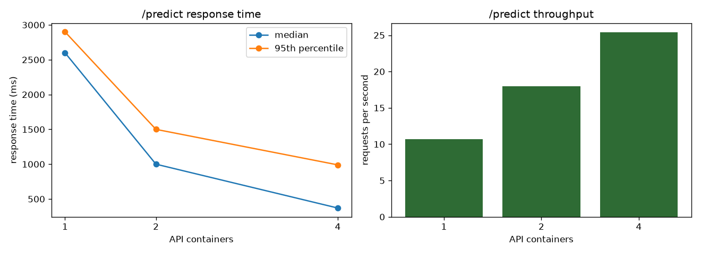

# Coffee Leaf Doctor

Classifies a photo of an Arabica coffee leaf as healthy, leaf rust, leaf miner, brown leaf spot (Phoma)
or Cercospora leaf spot. Includes a FastAPI service, a web dashboard, retraining from uploaded data,
a Render deployment and a Locust load test.

| | |
|---|---|
| Video demo | YOUTUBE_LINK |
| Live app | RENDER_URL (free tier: first request after 15 idle minutes takes about a minute) |
| API docs | RENDER_URL/docs |
| Notebook | [notebook/coffee_leaf_disease.ipynb](notebook/coffee_leaf_disease.ipynb) |

## Use case

Coffee is a major Rwandan export crop. Rust and other leaf diseases cut yields, and extension officers
cannot visit every farm. A phone photo gives farmers a first diagnosis, and retraining lets the model
improve as labelled local photos come in.

## Data

[BRACOL](https://data.mendeley.com/datasets/yy2k5y8mxg/1) (Krohling, Esgario & Ventura, 2019): phone
photos of single leaves on a white background, labelled by an expert with the predominant stress.

- `scripts/acquire_data.py` downloads it from Mendeley. The served zip is truncated, so the script
  reads local file headers and recovers 1,342 images.
- Stratified split: `data/train` 965, `data/test` 269, `data/new_data` 108 (unseen, used to demo retraining).
- JMuBEN (Kenya, 58,555 files) was rejected: it has about 1,260 distinct leaves after removing copies
  and rotated copies, 17 of them healthy. See the notebook.

## Model

MobileNetV2 (ImageNet) fine-tuned in two phases: frozen backbone, then the top 30 layers at a 10x
lower learning rate. Dropout, L2, augmentation, Adam, early stopping, ReduceLROnPlateau, class weights.

Test set (269 images):

| | Baseline (logistic regression on frozen features) | MobileNetV2 fine-tuned |
|---|---|---|
| Accuracy | 0.796 | **0.822** |
| Precision (macro) | | 0.784 |
| Recall (macro) | | 0.767 |
| F1 (macro) | 0.740 | **0.774** |
| Log loss | | 0.416 |
| ROC-AUC (macro, one-vs-rest) | | 0.965 |

Per class F1: brown leaf spot 0.97, healthy 0.91, rust 0.86, leaf miner 0.75, Cercospora 0.38
(smallest class, 98 training images).

Retraining on the 108 `new_data` images raised test accuracy from 0.848 to 0.874 in a
512 MB container (about 30 seconds).

Files: `models/coffee_leaf_model.keras` (served), `models/coffee_leaf_model.h5`.

## Insights

1. Class balance: rust has 3.4x more images than Cercospora or healthy, so training uses class weights.
2. Colour: healthy leaves are greenest with almost no lesion-coloured pixels (0.2%); rust and brown
   leaf spot have the most. Diseases overlap on colour, so shape and texture matter.
3. Texture and size: brown leaf spot leaves are the roughest and smallest. Miner trails are smooth,
   close to healthy.

## Retraining

1. Upload images (several files, or a zip with one folder per class). Each is validated and saved to
   the database with its label.
2. Uploaded images go through the same preprocessing as training.
3. The current model is loaded and its head is trained further on the new images plus a replay of
   the original training data.
4. The new version replaces the served model only if test accuracy drops by no more than one point.

Triggers: the Retrain button, or automatically once 50 unused images are uploaded (`RETRAIN_THRESHOLD`).

## API

| Method | Path | |
|---|---|---|
| GET | `/health` | status, uptime, model version |
| GET | `/model` | metrics and version history |
| POST | `/predict` | image in, class and probabilities out |
| POST | `/upload` | images or zip plus label, saved to the database |
| GET | `/uploads` | data waiting for retraining |
| POST | `/retrain` | start retraining |
| GET | `/retrain/status` | runs and logs |
| GET | `/evaluate` | evaluate the served model on the test set |
| GET | `/stats/dataset`, `/stats/predictions` | dashboard data |

## Load test

Locust, 40 users, 30 seconds per run, one CPU and 1 GB per container, nginx round-robin
(`compose.yaml`). Each container runs one inference at a time; extra requests queue.

| Containers | Requests | Failures | Req/s | Avg ms | Median ms | p95 ms | p99 ms |
|---|---|---|---|---|---|---|---|
| 1 | 311 | 0 | 10.7 | 2346 | 2600 | 2900 | 3000 |
| 2 | 522 | 0 | 18.0 | 1018 | 1000 | 1500 | 1600 |
| 4 | 736 | 0 | 25.4 | 428 | 370 | 990 | 1200 |



Going from 1 to 4 containers cut median latency 7x and raised throughput 2.4x. Throughput does not
scale linearly because Locust and the four containers share one 8-core laptop.

## Setup

Requires [uv](https://docs.astral.sh/uv/) and Docker.

```bash
uv sync
```

Optional, rebuilds the committed data splits:

```bash
uv run python -m scripts.acquire_data
```

Train (about 15 minutes on a laptop CPU, peak memory under 3 GB):

```bash
uv run jupyter lab notebook/coffee_leaf_disease.ipynb
```

Run the API and dashboard on <http://localhost:8000>:

```bash
uv run uvicorn src.api:app --port 8000
```

Or with Docker:

```bash
docker build -t coffee-leaf-api . && docker run -p 8000:8000 coffee-leaf-api
```

Predict from the command line:

```bash
uv run python -m src.prediction data/new_data/rust/bracol_1561.jpg
```

Load test with 1, 2 and 4 containers:

```bash
bash scripts/run_flood_test.sh 60 60s
```

Deploy: in Render choose New > Blueprint, select this repository, apply (`render.yaml`).

## Layout

```
notebook/coffee_leaf_disease.ipynb
src/        preprocessing.py  model.py  prediction.py  retrain.py  database.py  insights.py  api.py  config.py
data/       train/  test/  new_data/
models/     coffee_leaf_model.keras  coffee_leaf_model.h5  model_metadata.json  *.npz
static/     dashboard
scripts/    acquire_data.py  build_notebook.py  run_flood_test.sh  summarize_flood_test.py
locust/     locustfile.py  results/
Dockerfile  compose.yaml  deploy/nginx.conf  render.yaml
```
